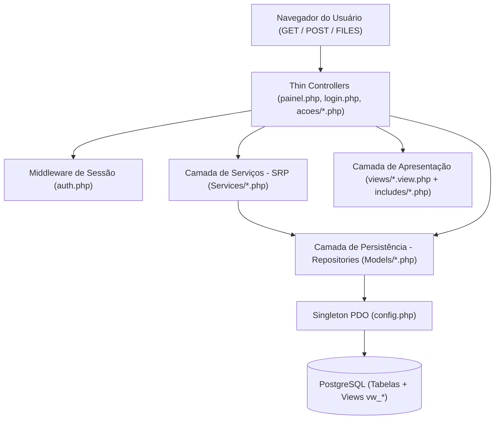
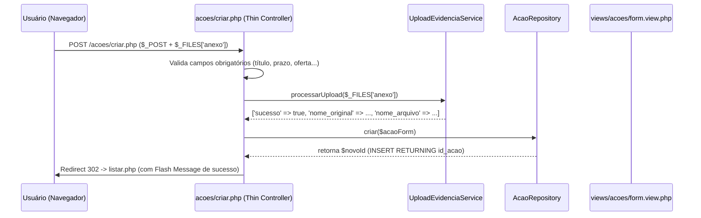

# Documentação de Arquitetura (`app/`)

Este documento detalha a arquitetura em camadas adotada no projeto **Painel ENADE · Recorte R05 (História e Pedagogia)**, desenvolvido em **PHP puro + PDO + PostgreSQL**.

---

## 1. Visão Geral das Camadas

O sistema foi projetado para evitar o acoplamento entre consultas SQL (`PDO`), regras de negócio (cálculos e upload de arquivos) e código de interface (`HTML`).

---

## 2. Detalhamento por Camada

### 2.1. Configuração e Conexão (`app/config.php`)
- **Responsabilidade:** Abrir e fornecer a instância `PDO` conectada ao banco `dw_projeto_enade` no PostgreSQL.
- **Padrão aplicado:** *Singleton* procedural por requisição utilizando `static $pdo = null;` dentro de `conectar(): PDO`.
- **Configuração local:** Permite sobrescrever a senha padrão sem alterar arquivos versionados por meio de `app/config.local.php`.

### 2.2. Middleware de Autenticação e Helpers (`app/auth.php`)
- **Responsabilidade:** Controlar o ciclo de vida da sessão (`$_SESSION`), proteger rotas restritas e oferecer funções utilitárias globais para as views e controllers.
- **Principais funções:**
  - `caminhoBaseApp(): string` — Calcula dinamicamente se o script atual está na raiz de `app/` (`.`) ou na subpasta `app/acoes/` (`..`), mantendo todos os links do menu e assets funcionais.
  - `e(mixed $valor): string` — Escapa qualquer saída com `htmlspecialchars(..., ENT_QUOTES, 'UTF-8')` para prevenir ataques de **XSS**.
  - `usuarioLogado(): ?array` — Retorna os dados do usuário autenticado na sessão ou `null`.
  - `exigirLogin(): void` — Bloqueia o acesso de visitantes não autenticados e redireciona para `login.php`.
  - `autenticarUsuario(PDO $pdo, string $login, string $senha): bool` — Consulta a tabela `usuario`, valida o hash `bcrypt` com `password_verify()` e regenera o ID da sessão (`session_regenerate_id(true)`).
  - `encerrarSessao(): void` — Limpa `$_SESSION`, invalida o cookie de sessão e destrói a sessão no servidor.
  - `definirMensagem(string $tipo, string $texto): void` e `obterMensagem(): ?array` — Implementam alertas temporários (*Flash Messages*) entre redirecionamentos HTTP (padrão *Post-Redirect-Get*).

---

### 2.3. Camada `Models/` (Pattern Repository)

Isola 100% das instruções SQL (`SELECT`, `INSERT`, `UPDATE`, `DELETE`) usando `PDO` e *Prepared Statements*.

#### `IndicadorEnadeRepository.php`
Responsável exclusivamente pela leitura das **Views analíticas** do banco de dados:
| Método | View Consultada | Retorno |
|---|---|---|
| `listarOfertas(): array` | `vw_oferta` | Lista de ofertas do recorte R05 (`id_oferta`, `curso`, `grau_academico`, `modalidade`, `rotulo`). |
| `listarAnos(): array` | `vw_anos` | Lista de anos disponíveis ordenados de forma decrescente (`2025` até `2015`). |
| `buscarCobertura(): ?array` | `vw_cobertura` | Totais consolidados do recorte (`ofertas`, `resultados`, `resultados_oficiais`, `resultados_simulados`, etc.). |
| `buscarResultado(int $idOferta, int $ano): ?array` | `vw_resultado` | Indicadores completos de uma oferta em uma edição específica. |
| `listarHistoricoPorOferta(int $idOferta): array` | `vw_resultado` | Série histórica completa (`2015–2025`) de uma oferta ordenada por ano crescente. |

#### `AcaoRepository.php`
Responsável pelo **CRUD completo** da entidade `acao` e leitura enriquecida pela `vw_acao`:
| Método | Tabela / View | Descrição |
|---|---|---|
| `listar(?int $idOferta, ?string $situacao): array` | `vw_acao` | Lista ações com filtros dinâmicos opcionais por oferta e situação. |
| `buscarPorId(int $idAcao): ?array` | `vw_acao` | Busca uma ação específica pelo ID, incluindo `oferta_rotulo` e `tem_anexo`. |
| `criar(array $dados): int` | `acao` | Executa `INSERT ... RETURNING id_acao`, garantindo a constraint `ck_anexo_completo`. |
| `atualizar(int $idAcao, array $dados): bool` | `acao` | Executa `UPDATE` nos dados e colunas de anexo da ação. |
| `excluir(int $idAcao): bool` | `acao` | Executa `DELETE FROM acao WHERE id_acao = :id_acao`. |
| `contarPorSituacao(?int $idOferta): array` | `acao` | Agrupa e soma ações por situação (`Planejada`, `Em andamento`, `Concluída` e `total`). |

---

### 2.4. Camada `Services/` (Princípio da Responsabilidade Única — SRP)

#### `UploadEvidenciaService.php`
Isola toda a validação e manipulação de arquivos enviados pelo formulário de ações:
1. Verifica se algum arquivo foi enviado (`UPLOAD_ERR_NO_FILE` é tratado como válido, pois o anexo é opcional).
2. Valida o limite máximo de **2 MB** (`2 * 1024 * 1024` bytes).
3. Valida a extensão do arquivo (`.pdf`, `.png`, `.jpg`, `.jpeg`).
4. Inspeciona o **MIME type real** do conteúdo binário com `finfo_file()` (`application/pdf`, `image/png`, `image/jpeg`), evitando arquivos executáveis disfarçados.
5. Gera um nome único de armazenamento (`evidencia_YYYYmmdd_HHMMSS_random.ext`) e move o arquivo para `app/uploads/`.
6. Oferece `removerArquivo(?string $nomeArquivo)` para excluir anexos antigos do disco quando uma ação é editada ou excluída.

#### `PainelEstatisticasService.php`
Orquestra `IndicadorEnadeRepository` e `AcaoRepository` para entregar um pacote pronto (`$dadosPainel`) para `views/painel.view.php`:
1. Resolve os filtros `id_oferta` e `ano` (aplicando valores padrão seguros caso não venham na URL).
2. Formata os **4 Cards Principais** (Conceito Faixa + Contínuo + Variação, Taxa de Participação, Notas FG × CE e Cobertura do Recorte).
3. Calcula os percentuais (`0%` a `100%`) das **Barras de Desempenho**.
4. Prepara a **Série Histórica (2015–2025)** com altura proporcional para o gráfico de colunas em CSS e flags de destaque para dados `OFICIAL_INEP` vs. `SIMULADO_DIDATICO`.
5. Monta a **Síntese Interpretativa** com leitura automática da diferença `diferenca_fg_ce` (`Formação Geral - Componente Específico`).

---

### 2.5. Camada de Controladores ("Thin Controllers")

Cada arquivo `.php` acessível pela URL funciona apenas como ponto de entrada HTTP:

---

### 2.6. Camada de Apresentação (`app/views/` e `app/includes/`)
- **Desacoplamento total de SQL:** Nenhuma view abre conexão nem executa queries.
- **Reaproveitamento de formulário (`views/acoes/form.view.php`):** Tanto `acoes/criar.php` (`$modoEdicao = false`) quanto `acoes/editar.php` (`$modoEdicao = true`) carregam exatamente a mesma view.
- **Proteção na pasta de uploads (`app/uploads/.htaccess`):** Desativa listagem de diretório (`Options -Indexes`) e bloqueia a execução de scripts (`.php`, `.phtml`, `.phar`, `.sh`, `.py`, `.cgi`), garantindo que arquivos enviados nunca possam ser executados pelo Apache.
