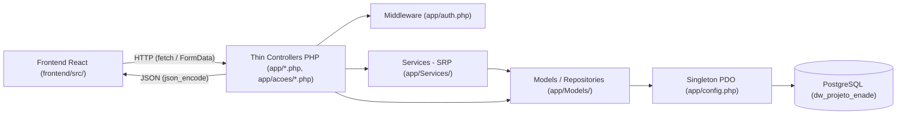

# Arquitetura do Projeto (Backend PHP API + Frontend React)

Este documento descreve a organização arquitetural do **Painel ENADE · Recorte R05 (História e Pedagogia)**, dividindo a responsabilidade entre o **Backend em PHP Puro (API JSON + PDO + PostgreSQL)** em `app/` e a **Interface em React (SPA)** em `frontend/`.

---

## 1. Árvore do Projeto

```text
DW_Grupo06_PainelENADE/
├── README.md
├── app/                                    # BACKEND: API REST/JSON em PHP Puro + PDO
│   ├── config.php                          # Apenas retorna a instância do PDO (Singleton)
│   ├── auth.php                            # Middleware de sessão, CORS e helpers de resposta JSON
│   │
│   ├── Models/                             # Isola todos os SELECT / INSERT / UPDATE / DELETE (PDO)
│   │   ├── AcaoRepository.php              # CRUD na tabela `acao` e leitura em `vw_acao`
│   │   └── IndicadorEnadeRepository.php    # Leitura das views `vw_oferta`, `vw_anos`, `vw_resultado`, `vw_cobertura`
│   │
│   ├── Services/                           # (SRP) Isola regras de negócio e upload
│   │   ├── UploadEvidenciaService.php      # Valida PDF/PNG/JPG e máx. 2 MB e salva em uploads/
│   │   └── PainelEstatisticasService.php   # Calcula cards, barras, série histórica e síntese
│   │
│   ├── login.php                           # Endpoint API (POST): chama auth.php e retorna JSON
│   ├── logout.php                          # Endpoint API (POST): destrói sessão e retorna JSON
│   ├── painel.php                          # Endpoint API (GET): chama PainelEstatisticasService e retorna JSON
│   │
│   ├── acoes/                              # Funcionam apenas como "Thin Controllers" (retornam JSON)
│   │   ├── listar.php                      # GET: lista ações via AcaoRepository
│   │   ├── criar.php                       # POST (FormData): UploadEvidenciaService -> AcaoRepository
│   │   ├── editar.php                      # POST (FormData): atualiza ação e anexo
│   │   ├── visualizar.php                  # GET (?id=): retorna detalhes de uma ação
│   │   └── excluir.php                     # POST/DELETE: remove arquivo em uploads/ e apaga no banco
│   │
│   └── uploads/
│       └── .htaccess                       # Bloqueia execução de scripts maliciosos no upload
│
├── frontend/                               # FRONTEND: Interface do Usuário em React
│   ├── package.json
│   └── src/
│       ├── main.jsx                        # Ponto de entrada do React
│       ├── App.jsx                         # Rotas do frontend (React Router)
│       ├── services/
│       │   └── api.js                      # Cliente HTTP (fetch/axios) que conversa com `app/`
│       ├── components/
│       │   ├── Header.jsx                  # Cabeçalho e navegação
│       │   ├── Footer.jsx                  # Rodapé institucional
│       │   └── AcaoForm.jsx                # Formulário reaproveitado em CriarAcaoPage e EditarAcaoPage
│       ├── pages/
│       │   ├── LoginPage.jsx               # Tela de Login
│       │   ├── PainelPage.jsx              # Dashboard de Indicadores ENADE
│       │   └── acoes/
│       │       ├── ListaAcoesPage.jsx      # Listagem e filtros do CRUD
│       │       ├── CriarAcaoPage.jsx       # Cadastro de nova ação
│       │       ├── EditarAcaoPage.jsx      # Edição de ação existente
│       │       └── VisualizarAcaoPage.jsx  # Visualização detalhada e anexo
│       └── styles/
│           └── global.css
│
├── banco/
│   ├── estrutura.sql
│   └── dados_iniciais.sql
└── docs/
    └── ARQUITETURA.md
```

---

## 2. Fluxo de Comunicação (React ↔ PHP ↔ PostgreSQL)



---

## 3. Responsabilidade de Cada Camada

1. **Frontend (`frontend/src/`):**
   - Cuida exclusivamente da interface visual, estados de tela e rotas do navegador.
   - Faz requisições assíncronas (`fetch` / `axios` em `src/services/api.js`) para os endpoints `.php` da pasta `app/`.
   - O componente `AcaoForm.jsx` substitui a antiga view PHP de formulário, sendo reaproveitado tanto em `CriarAcaoPage.jsx` quanto em `EditarAcaoPage.jsx`.

2. **Thin Controllers / Endpoints (`app/painel.php`, `app/login.php`, `app/acoes/*.php`):**
   - Não possuem HTML.
   - Apenas validam a sessão (`auth.php`), leem os parâmetros da requisição (`$_GET`, `$_POST`, `$_FILES`), acionam os `Services` e `Models`, e devolvem a resposta em **JSON** (`header('Content-Type: application/json')`).

3. **Camada `Services/` (SRP — Responsabilidade Única):**
   - `PainelEstatisticasService.php`: monta o array consolidado com cards, barras comparativas, série histórica e síntese para ser convertido em JSON pelo `painel.php`.
   - `UploadEvidenciaService.php`: valida se o arquivo enviado no `FormData` do React é `PDF`, `PNG` ou `JPG`, se tem até `2 MB` e o salva com nome único em `app/uploads/`.

4. **Camada `Models/` (Pattern Repository):**
   - `IndicadorEnadeRepository.php` e `AcaoRepository.php`: únicos arquivos do sistema que executam SQL (`SELECT`, `INSERT`, `UPDATE`, `DELETE`) via `PDO` usando a conexão única de `config.php`.
